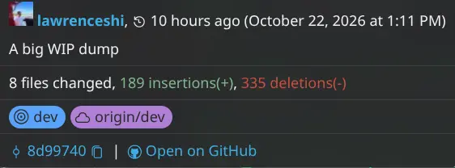

# Devlog \#6

I truly didn't work on this project for a long time. I was trying to warp up by fixing some few bugs, trying to organize some of my uncommitted changes, and testing!

I still need a README, and I plan to ship after a finish it!

This project really changed a lot and shift from my original thoughts at the start!

Good luck for me!

---

👇 Me failing to manage my code clearly.
* I'll probably `git reset --soft` and separate this huge chunk.

