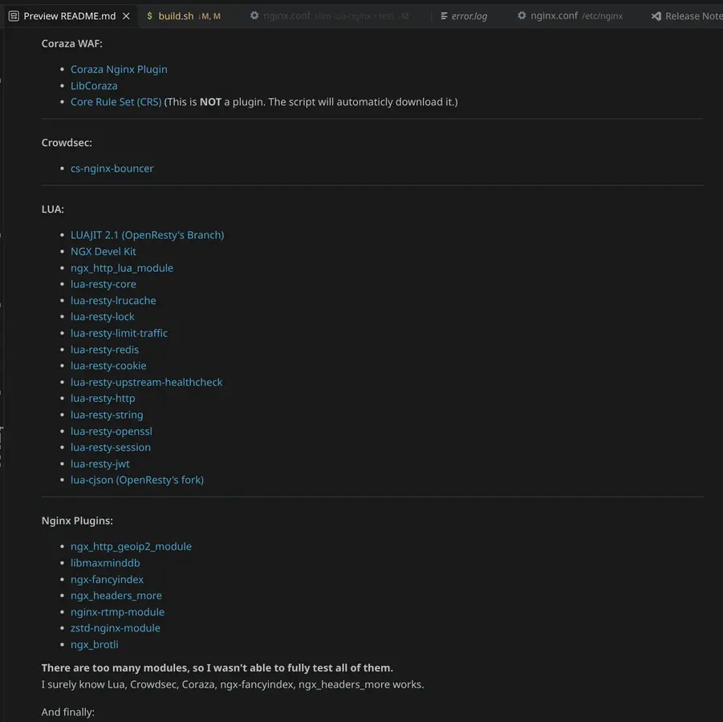

# Devlog \#7

Hi!

I have broke down that  big commits into smaller peaces (See [Devlog \#6](https://stardance.hackclub.com/projects/24418/devlogs/68476)), merged the two Containerfiles into one, and wrote haft of my README.

I also added support to automatically download the Core Rule Set  and [ngx_http_lua_upstream](https://github.com/openresty/lua-upstream-nginx-module) (I found out I missed it before, it was a dependency of lua-resty-upstream-healthcheck)

I wanted to keep my DevLog short and clear. I think that's enough. Also, I hope I can ship today!