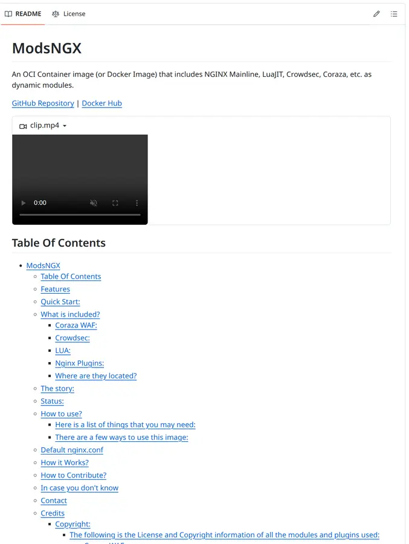

# Devlog \#8

Final Devlog!

I was working hardly on the `REAMD.md`. It took a long time to list every author and licenses of all of the modules and plugins. I kinda put all the copyright stuff in the README, because that works the best for me.

Additionally, I uploaded the image to Docker Hub, fixed more bugs, did the finally testing, and added a video.

The video may not load as expected, however this is a CORS problem with GitHub. I don't know how to solve it.