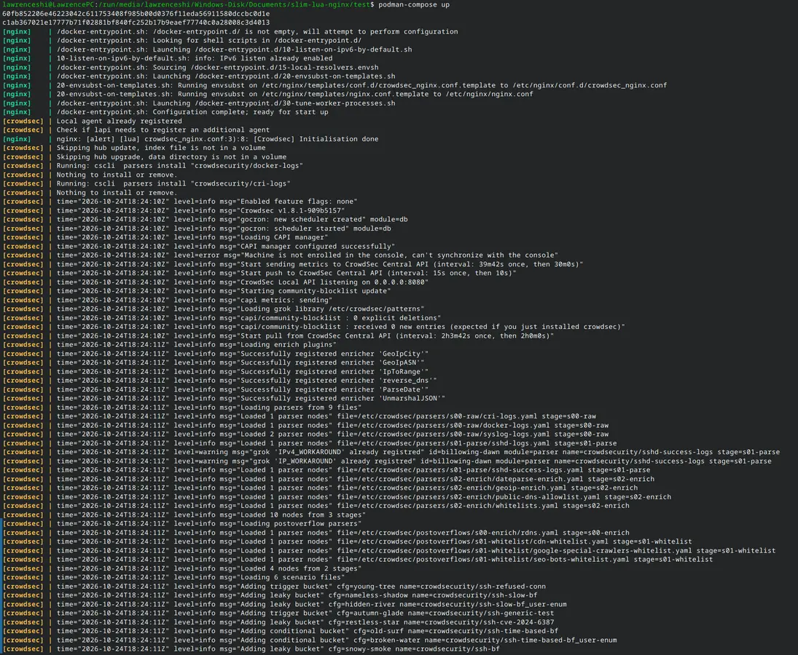

I made a Container Image that repacks Nginx with ngx_http_lua_module, cs-nginx-bouncer, coraza-nginx, and more nginx modules as dynamic modules. I also include many lua plugins See the full list in README.md.

The challenging part is to install the all dependency of a module. The module may have a few dependencies, and the dependency may also have some dependencies. Another challenging part is testing and solving countless bugs.

I am proud of that I really solved a problem I had when I was building up a website using nginx. I needed some plugins, but I needed to compile Nginx from source. Now, users including me only need to pull the image from Docker Hub to use the modules.

People should have basic experience with Nginx before they test and use my project.